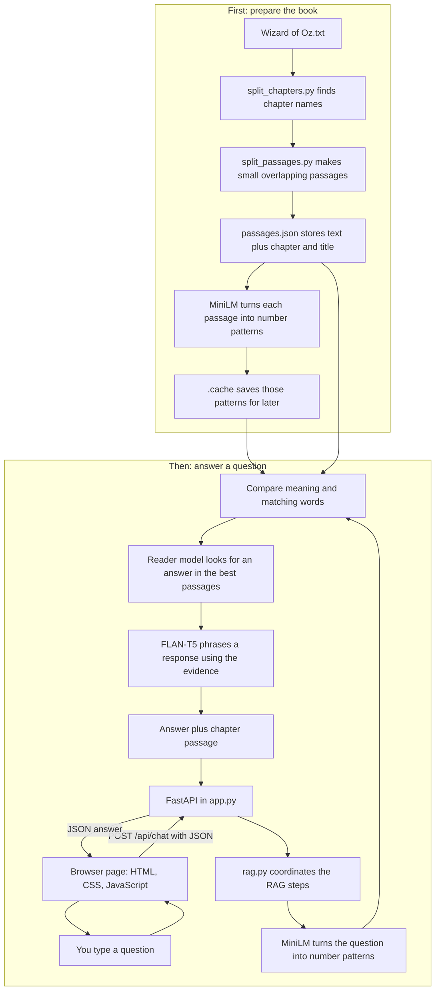

# AI Coach Guide: How This App Works

This guide explains the Oz Book Companion in everyday language. You do not need to know the technical words first.

## The short version

The app does four jobs:

**Read the book → find useful passages → let the AI read them → show an answer with its source.**

The AI does not search the whole internet. It gets passages from the included book and uses those as evidence.

## The whole flow



Everything in this diagram is part of the current **local** app. The models run on your computer; a hosted service and API key are not involved.

## First, prepare the book

| Part | In plain language | Receives | Produces | Why it exists |
|---|---|---|---|---|
| `Wizard of Oz.txt` | The book file | The original story text | Raw book text | This is the information the chatbot is allowed to use. |
| `split_chapters.py` | Finds chapter headings and titles | Raw book text | A list of chapters, each with its title and text | It helps the app keep chapter information attached to the story. |
| `split_passages.py` | Cuts chapters into smaller pieces | Chapter text | About 180-word passages, with a little repeated text between neighbors | Small pieces are easier to search than the entire book. The overlap helps keep a thought from being cut at a passage boundary. |
| `passages.json` | A labeled shelf of text pieces | The chapter list | JSON entries with `id`, `chapter`, `title`, and `text` | Search can retrieve a piece and the app can still show where it came from. |
| MiniLM embeddings | Numeric descriptions of passage meaning | Each passage's text | A vector (a list of numbers) for each passage | It helps find related ideas even when the question uses different words. |
| `.cache` | A local shortcut | Passage vectors | A saved NumPy file | The app can reuse the vectors next time instead of recalculating them. |

A vector is just a list of numbers the model uses to represent meaning. This prototype keeps those lists in a file and searches them in memory. It does not use a separate vector database.

## Then, answer one question

| Part | In plain language | Receives | Produces |
|---|---|---|---|
| Browser page | The screen you use | Your typed question | A small JSON request sent to the backend |
| FastAPI (`app.py`) | The doorway between the page and Python | A request to `POST /api/chat` | It passes the question to RAG and later returns the result as JSON |
| Passage search (`rag.py`) | A librarian looking through the book | The question, passage text, and saved vectors | A ranked set of passages that may be useful |
| Reader model | A highlighter looking for a possible answer phrase | The question and retrieved passages | A likely answer span and the passage it came from |
| FLAN-T5 answer model | A short-answer writer | The question and selected book evidence | A short answer based on that text |
| Browser chat | The result display | JSON with the answer and source details | The answer and an expandable chapter passage |

The search combines two clues:

- **Meaning clue:** MiniLM checks whether the passage is conceptually related to the question.
- **Word clue:** BM25 gives weight to meaningful words that appear in both the question and passage.

Using both can be more helpful than matching exact words alone. The app then checks the retrieved text for a likely answer before asking FLAN-T5 to phrase one. If evidence looks too weak, it is designed to say it could not find enough information.

## How the browser talks to Python

When you submit a question, the browser sends a request like this:

```json
{"question": "Where does Dorothy live?"}
```

It sends that JSON to the local address `POST /api/chat`. FastAPI passes the question into `rag.py`. After search and answer generation, the backend returns JSON containing an answer and source passages. JavaScript reads that response and adds it to the conversation.

The browser does not load the AI models. Python does.

## What are MiniLM and FLAN-T5?

A **model** is a trained AI program that learned patterns from examples. GPT-4o mini is another model name; it is a different model made by OpenAI. Models can have different sizes and jobs.

In this app, the names refer to particular trained models that Python loads and uses:

- **MiniLM** is from the MiniLM model family. Our `all-MiniLM-L6-v2` model turns text into number patterns that help compare meanings. It is the book-search helper; it does not write the chat answer.
- **FLAN-T5** is Google's instruction-trained version of the T5 model family. Our `google/flan-t5-base` model gets the question and book evidence, then tries to phrase a response.
- **The reader model** (`deepset/minilm-uncased-squad2`) has a different job: it looks inside the found passages for words that may answer the question.

Think of Python as the worker and the models as tools the worker uses. The Python code loads a model and calls it for a particular job. All three models in this version run on your computer; they are not GPT-4o mini and do not need an API key.

## What the main files do

- `static/index.html` describes the chat page elements.
- `static/style.css` controls colors, layout, typography, and mobile styling.
- `static/chat.js` sends questions and displays the returned answers and source passages.
- `app.py` serves the pages and provides the API endpoints.
- `rag.py` searches passages and runs the local AI models.
- `split_chapters.py` and `split_passages.py` prepare the book data.

The frontend is plain HTML/CSS/JavaScript, not React. For this small app, that keeps the number of concepts and dependencies lower while you learn how the browser and API connect.

## How to run it

In PowerShell:

```powershell
cd "C:\Users\Janice\OneDrive\Documents\ChatGPT\RAG"
powershell -ExecutionPolicy Bypass -File .\start.ps1
```

Then open `http://127.0.0.1:8000`. On first setup, the project downloads the model files and prepares the passages. Stop it with **Ctrl+C** in PowerShell.

To run the API tests:

```powershell
.\.venv\Scripts\python.exe -m unittest test_app -v
```

## A few useful words

- **Backend:** the part running on the server/computer. Here it is Python and FastAPI.
- **Frontend:** the page in the browser. Here it is HTML, CSS, and JavaScript.
- **API:** the agreed route the browser uses to ask the backend for an answer.
- **Passage:** a small piece of the book, labeled with its chapter and title.
- **Embedding/vector:** numbers that stand in for the meaning of text, so related passages can be found.
- **RAG:** “Retrieval-Augmented Generation”—retrieve useful text first, then generate an answer using that text.
- **LLM:** the language model that writes the answer. This app's FLAN-T5 model runs locally.

## What this app does not do yet

It is a local learning demo, not a public website. It does not save chat history, use accounts, or use an external API key. The included models are small enough for a local CPU demo, so answers can be slow or incomplete. If you later put it online with Cloudflare, the hosted AI step will need a different setup; the current local model files cannot simply be copied into a standard Worker.
