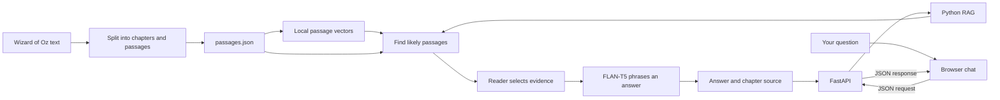

# Oz Book Companion

A small, local RAG chatbot for *The Wonderful Wizard of Oz*. Ask a question in everyday language, get an answer based on the book, and open the cited chapter passage to check the evidence.

This is a learning and portfolio project. The browser interface uses HTML, CSS, and JavaScript; a Python API retrieves passages and runs the AI models locally. It does not require a hosted AI service or an API key.

## What it does

- Splits the book into chapter-aware passages.
- Finds relevant passages using both meaning-based search and word matching.
- Uses an extractive reader to locate a likely answer in the retrieved text.
- Uses FLAN-T5 to phrase an answer using the question and book evidence.
- Shows the supporting chapter and passage in the chat.
- Declines when it cannot find enough evidence.
- Includes a plain-language [How RAG works](http://127.0.0.1:8000/how-rag) page.

## Run locally on Windows

Open PowerShell and run:

```powershell
cd "C:\Users\Janice\OneDrive\Documents\ChatGPT\RAG"
powershell -ExecutionPolicy Bypass -File .\start.ps1
```

Then open [http://127.0.0.1:8000](http://127.0.0.1:8000). The first run installs the Python packages, prepares `passages.json`, and downloads the model files from Hugging Face. It also creates a local embedding cache. The first setup needs an internet connection and may take a while; subsequent runs use the downloaded files. Stop the server with **Ctrl+C** in PowerShell.

If package installation was interrupted, run:

```powershell
.\.venv\Scripts\python.exe -m pip install -r requirements.txt --extra-index-url https://download.pytorch.org/whl/cpu
```

## How the pieces fit



All model steps currently run locally on the computer running Python. This is not yet a public deployment. Hosting the site on Cloudflare would require changing how the backend runs AI inference.

## Project files

- `app.py` — FastAPI routes for the pages, readiness check, and chat API.
- `rag.py` — passage retrieval, evidence selection, and local answer generation.
- `split_chapters.py` — finds each chapter and title in the book text.
- `split_passages.py` — creates overlapping 180-word passages, keeping chapter boundaries.
- `passages.json` — prepared text passages with chapter and title metadata.
- `static/` — browser pages, styling, chat JavaScript, and the Oz illustration.
- `AI_COACH_GUIDE.md` — a plain-language architecture guide for learning the project.

## Try the checks

Run the API tests:

```powershell
.\.venv\Scripts\python.exe -m unittest test_app -v
```

Run the model-backed quality check (this loads the real local models):

```powershell
.\.venv\Scripts\python.exe check_chatbot.py
```

The quality check asks four book questions and checks that the answers mention expected evidence, then checks that an unrelated question is declined.

## Models and limits

- [all-MiniLM-L6-v2](https://huggingface.co/sentence-transformers/all-MiniLM-L6-v2) creates vectors for semantic search.
- [MiniLM SQuAD2 reader](https://huggingface.co/deepset/minilm-uncased-squad2) looks for an answer span in passages.
- [FLAN-T5 base](https://huggingface.co/google/flan-t5-base) generates a short answer from the supplied evidence.

The models run on the local CPU. This keeps the demo independent of an API key, but answers may be slow and the small generator can miss details or phrase a response poorly. A cited passage is useful evidence, but readers should still check it. Questions work best when they ask directly about people, places, or events in the book. The conversation is held in the browser and is cleared when refreshed or when **New chat** is selected.

The included text file retains its Project Gutenberg attribution and license information. The story text is used for this book companion.
